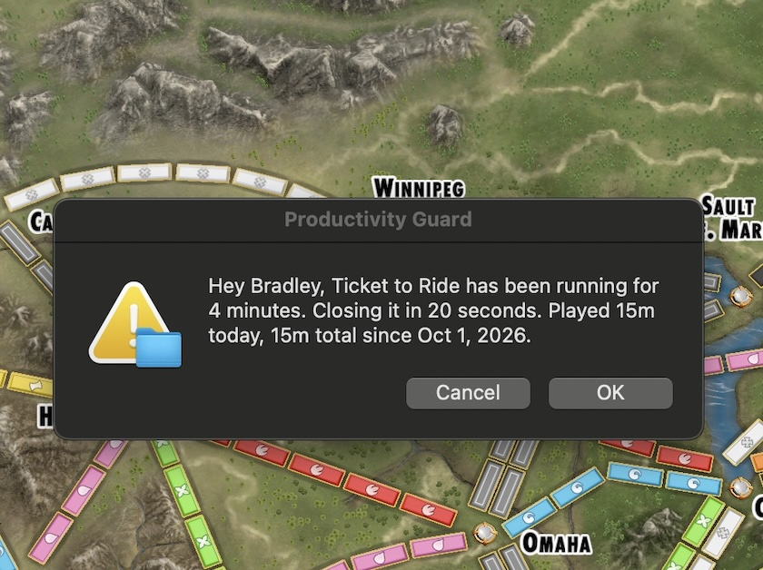

# productivity-guard

A macOS LaunchAgent that watches for Steam and nags/force-quits it after a
time limit. Tested for compatibility with **macOS Sonoma 14.7**.



## What it does

`productivity_guard.py` runs once a minute (via launchd) and checks whether Steam
is "active" — either the Steam client (`steam_osx`) or any game launched
from Steam's library is running. Both are checked because quitting the
Steam client window does not kill an already-running game on macOS; if
only `steam_osx` were checked, a game left running after Steam quit would
never get timed out.

- When Steam becomes active, it records the launch time in
  `/tmp/steam_timer_start`.
- At **1, 2, and 3 minutes** (`WARN_MINUTES_1/2/3` in the script), it pops
  up a modal alert (via `osascript`) warning that Steam will be closed
  soon, and showing today's and your all-time playtime. Each alert fires
  only once per session and auto-dismisses after 30 seconds if ignored.
- At **5 minutes** (`KILL_MINUTES`), it shows a final alert, waits
  `KILL_WARNING_SECONDS` (20s by default) so you actually get to see it,
  then force-terminates
  the Steam client (`steam_osx`, `Steam Helper`) with `pkill -9`, along
  with any game currently running from Steam's library (matched by
  `/steamapps/common/` in the process path, so this covers any title, not
  just one game).
- If Steam isn't active, all timer state is cleared so the next session
  starts a fresh countdown.
- Every minute Steam is active, `data/playtime.json` (gitignored, kept
  local to this repo) accumulates total playtime. See
  [Playtime tracking](#playtime-tracking) below.

## Prerequisites

- macOS Sonoma 14.7 (or later).
- Python 3, installed at `/opt/homebrew/bin/python3` (Homebrew's default
  location). launchd runs with its own minimal PATH, so the plist points at
  this absolute path rather than relying on PATH lookup. If your `python3`
  lives elsewhere, update the path in `com.user.productivityguard.plist`.
- Steam installed. On macOS, Steam's client process is named `steam_osx`
  (not `steam`) and its helpers are named `Steam Helper` (not
  `steamwebhelper`) — confirm on your machine with
  `ps -axo comm | grep -i steam` while Steam is running. If your install
  reports different names, update `STEAM_PROCESS` / `STEAM_HELPER_PROCESS`
  at the top of `productivity_guard.py` to match.
- You may need to grant your terminal/launchd's `osascript` permission to
  show notifications/dialogs the first time it runs (System Settings →
  Privacy & Security → Automation / Notifications).

## Manual installation (launchctl)

1. Make the script executable:
   ```bash
   chmod +x productivity_guard.py
   ```
2. Copy the plist into your LaunchAgents directory, substituting the real
   path to `productivity_guard.py` (plists can't expand `~`):
   ```bash
   sed "s|__SCRIPT_PATH__|$HOME/Development/productivity-guard/productivity_guard.py|g" \
       com.user.productivityguard.plist > ~/Library/LaunchAgents/com.user.productivityguard.plist
   ```
3. Load it:
   ```bash
   launchctl load ~/Library/LaunchAgents/com.user.productivityguard.plist
   ```
4. Verify it's loaded:
   ```bash
   launchctl list | grep com.user.productivityguard
   ```

## Automated installation

```bash
./install.sh
```

This substitutes the correct absolute path into the plist, copies it to
`~/Library/LaunchAgents/`, and loads it with `launchctl`. Safe to re-run
(it unloads any previous copy first).

## Verifying it's installed and running

Quick checks to confirm the LaunchAgent is actually active, without
waiting for a Steam session:

```bash
# Is it loaded? ("-" in the PID column just means it's idle between runs,
# not that it's broken. The number after it is the last exit code.)
launchctl list | grep com.user.productivityguard

# Full status: confirms the script path launchd is using, how many times
# it has run, and its last exit code (0 = success).
launchctl print gui/$(id -u)/com.user.productivityguard

# Any errors logged by the script or launchd itself?
cat /tmp/com.user.productivityguard.out.log
cat /tmp/com.user.productivityguard.err.log

# One-shot debug summary: active?, which game, elapsed time, which
# warnings already fired, and seconds remaining until the kill threshold.
# Read-only -- doesn't touch playtime stats or fire any dialogs.
./productivity_guard.py status
```

Example output while a game is running:

```
Steam/game: ACTIVE (Ticket to Ride)
Running for: 2m (138s)
Warnings fired: 1,2,
Time to kill: 162s (~3m)
```

`launchctl print` showing `runs = N` with `N` increasing roughly once a
minute, and `last exit code = 0`, confirms launchd is calling the script
on schedule and it's exiting cleanly. If `/tmp/steam_timer_start` appears
and updates while Steam is open, the detection logic is working too.

## Testing

The default thresholds (1/2/3/5 minutes) are already fast enough to
verify by hand. To go even faster, edit the variables at the top of
`productivity_guard.py`, then reload the agent so launchd picks up the
change:

```bash
launchctl unload ~/Library/LaunchAgents/com.user.productivityguard.plist
launchctl load ~/Library/LaunchAgents/com.user.productivityguard.plist
```

Launch Steam and watch for dialogs at each threshold, checking
`./productivity_guard.py status` (see above) along the way. You can also
run the script directly, bypassing launchd, to see its behavior
immediately:

```bash
./productivity_guard.py
```

Check `/tmp/com.user.productivityguard.out.log` /
`/tmp/com.user.productivityguard.err.log` for launchd output.

Remember to restore the original threshold values (or reinstall from a
clean checkout) once you're done testing.

## Playtime tracking

`data/playtime.json` tracks how long you've played, independent of the
warning timer. It's a JSON array with one entry per calendar day:

```json
[
  {"date": "2026-10-15", "minutes_played": 42, "game": "Ticket to Ride"},
  {"date": "2026-10-16", "minutes_played": 10, "game": "Ticket to Ride"}
]
```

- `date` / `minutes_played` — that day's playtime. A new entry is appended
  automatically on each new calendar day; past entries are never modified.
- `game` — that day's most recently running game, by folder name under
  Steam's `steamapps/common/`, e.g. "Ticket to Ride". Empty if only the
  Steam client was open with no game running.

The all-time total shown in dialogs ("Xh Ym total since Oct 1, 2026") is
`HISTORICAL_MINUTES` (a fixed constant in `productivity_guard.py`, covering
play before this log existed) plus the sum of every entry's
`minutes_played`.

This file lives inside the repo, under `data/`, to keep everything
contained in one place rather than scattered across `/tmp` and dotfiles.
It's listed in `.gitignore`, so your personal playtime stats are never
committed or pushed to this (public) GitHub repo.

## Uninstallation

```bash
launchctl unload ~/Library/LaunchAgents/com.user.productivityguard.plist
rm ~/Library/LaunchAgents/com.user.productivityguard.plist
rm -f /tmp/steam_timer_start /tmp/steam_timer_fired
```
